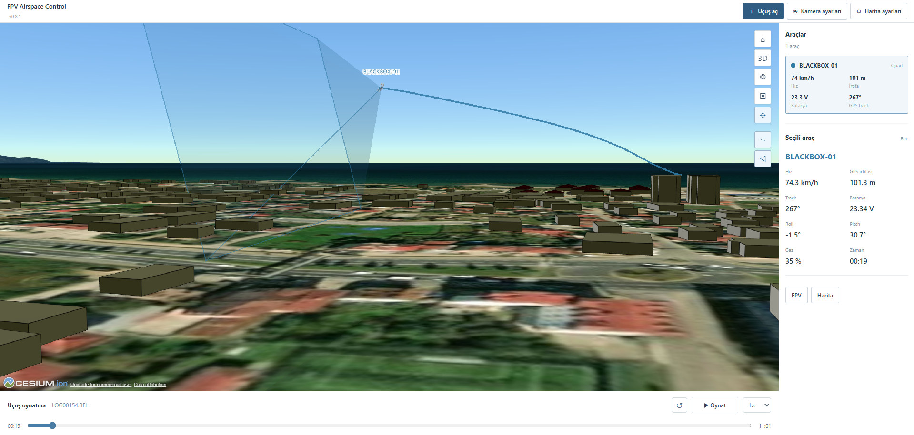
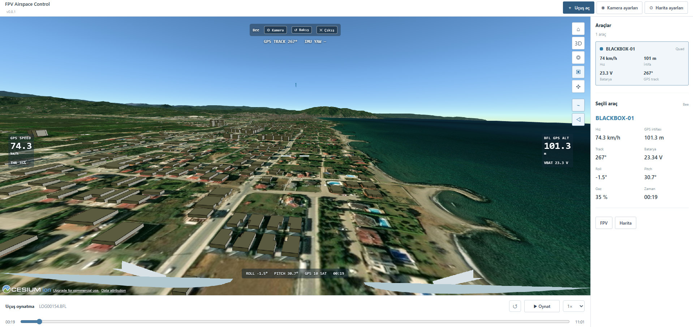

# Betaflight Blackbox Simulator

FPV uçuşlarımı kaydetmek için DVR kullanıyorum. Ama DVR'da yalnızca kameranın gördüğü şey var; uçuşun nereden geçtiğini ve o sırada drone'un ne yaptığını sonradan incelemek zor. Bu projeye de o yüzden başladım: Betaflight Blackbox kayıtlarını açıp uçuşu **3D harita üzerinde yeniden izleyebilmek** için.

Uygulama bir `.BFL` kaydından konum, hız, yön, irtifa ve mevcut diğer telemetri verilerini okuyabiliyor. Uçuş rotasını haritada görebiliyor, zaman çizelgesinden ileri geri sarabiliyor ve FPV kamera görünümüne geçebiliyorsun.

*Altınordu'da kaydettiğim uçuşun harita görünümü.*

*Blackbox verileriyle oluşturulan sanal FPV kamera görünümü.*

## Kurulum

Windows için:

1. Depoyu **Code → Download ZIP** ile indirip bir klasöre çıkar. İstersen `git clone` da kullanabilirsin.
2. Bilgisayarında [Python 3](https://www.python.org/downloads/windows/) kurulu olsun.
3. `start_windows.bat` dosyasını çalıştır. Tarayıcıda yerel uygulama açılacak.
4. **Harita ayarları** bölümüne kendi [Cesium ion](https://ion.cesium.com/tokens) erişim anahtarını gir. Harita katmanlarının düzgün yüklenmesi için internet gerekiyor.
5. **Uçuş aç** düğmesiyle `.BFL` veya `.BBL` dosyanı seç.

Python paketleri kurmana gerek yok. Program bilgisayarında yerel olarak çalışıyor; uçuş kaydı harita sunucusuna gönderilmiyor. Harita görüntüleri için Cesium servislerine bağlanıyor.

## Kullanım

- **Harita:** Uçuş rotasını incele, modeli takip et, kamera açısını değiştir.
- **FPV:** Birinci şahıs görünümüne geç. Sol tıkla sürükleyerek etrafa bak; `Esc` ile çık.
- **Zaman çizelgesi:** Kaydı durdur, geri sar veya oynatma hızını değiştir.
- **Kamera ayarları:** Görüş açısını, kamera ofsetlerini ve stabilizasyonu ayarla.
- **Uçuş izi:** Tüm rotayı göster veya yalnızca son belirlediğin saniyeleri göster.

`.GPX`, `.CSV`, `.JSON` ve `.GeoJSON` dosyaları da açılabiliyor. Bazı Blackbox sürümleri için [Betaflight blackbox-tools](https://github.com/betaflight/blackbox-tools) içindeki `blackbox_decode` gerekebilir (`tools/README.md`).

## Bilmen gerekenler

Bu uygulama DVR videosu oynatmıyor. FPV görüntüsü, 3D haritanın içinde oluşturulan **sanal kamera**. Özellikle yaw ve roll/pitch açıları, kayıtta bulunan alanlara göre tahmin edilebiliyor; gerçek kamerayla birebir aynı olmayabilir. GPS irtifasının referansı da uçuş kontrolcüsündeki kayda bağlı. Kullandığım Bee kaydı için 10× irtifa kalibrasyonu seçili; farklı kayıtlarda ayarlamak gerekebilir.

Şimdilik Windows'ta kullanıyorum. Uygulama Python'ın yerel HTTP sunucusu ile HTML/JavaScript üzerinde çalışıyor. 3D harita için CesiumJS kullanıyor.

Betaflight'ın resmî uygulaması değildir.
